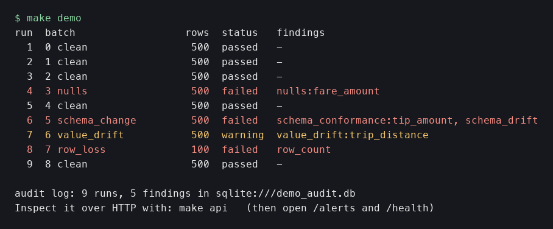
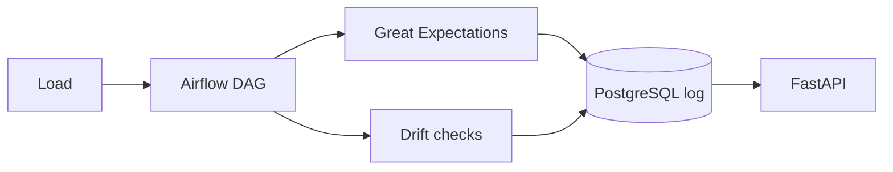

# Data Quality Framework

Checks every incoming data load for row counts, nulls, schema conformance and drift, runs from an Airflow DAG with Great Expectations, and writes an audit log to PostgreSQL that a FastAPI service exposes. A personal project for data engineers who want to see a load fail loudly before it reaches a warehouse.

Topics: data-quality, great-expectations, airflow, fastapi, postgresql, data-engineering, data-drift, python



## Results

Known defects are injected into clean 500 row loads and the checks run on both. Command: `make eval` (same as `python -m dqf.evaluate --trials 200 --seed 7`, 484 s on a laptop).

| Defect | Levels | Detection rate | False-positive rate |
|---|---|---|---|
| nulls | 2%, 10%, 30% of one column | 68.5%, 100.0%, 100.0% | 0.0% each |
| schema change | drop, rename, add, retype column | 100.0% each | 0.0% each |
| value drift | one column +5%, +20%, +50% | 4.5%, 91.0%, 100.0% | 0.0%, 1.5%, 0.5% |
| row loss | 80%, 50%, 10% of rows kept | 0.0%, 100.0%, 100.0% | 0.0% each |

Clean loads flagged by any check: 10 of 2600 (0.4%). Full table, caveats and data source: [docs/RESULTS.md](docs/RESULTS.md).

## How it works



- Great Expectations checks row count, columns, types and a null limit per column, using a baseline from `data/sample/reference.csv`.
- Schema drift compares with the last accepted schema and names the change.
- Value drift is a KS test per numeric column and is a warning, not an error.
- Every run and finding goes to PostgreSQL. The API only reads it.

## Design choices

- **Great Expectations for the contract, scipy for drift:** pass or fail rules fit GE, a distribution test is simpler as plain code.
- **Thresholds from the baseline:** a flat 5% null limit was too loose for clean columns and too tight for null-heavy ones.
- **Drift against the last accepted schema:** comparing with the previous load made the next good load look like a change.
- **Measure with injected defects:** the numbers come from a fixed seed script, not from "it caught issues".

## Run it

No keys needed.

```bash
make demo        # first run creates .venv (Python 3.12 or 3.13 on PATH) and installs the requirements; 9 loads, 4 with defects, 5 findings, SQLite audit log, a few seconds
make api         # then open http://localhost:8010/health and /alerts
```

Full stack with Airflow and PostgreSQL (about 2 GB of RAM, ports 5433, 8085, 8010 on localhost):

```bash
make stack-demo  # builds, triggers the DAG for 6 loads, prints /health and /alerts
make down        # removes containers and volumes
```

The Airflow UI is at http://localhost:8085 (user `admin`, password `admin`, local demo only). Trigger a load by hand:

```bash
docker compose exec airflow airflow dags trigger dq_validate_load --conf '{"batch_index": 2, "defect": "nulls"}'
```

The DAG has no schedule. It is meant to be triggered once per load by the pipeline that produced it. In the container, Airflow 2.10 brings its own pandas 2.1 and SQLAlchemy 1.4, and the same code ran on them in the stack demo.

## Tests

```bash
make test   # 24 tests plus 1 that skips outside Airflow (95% line coverage), pytest on the demo data
make lint   # ruff
```

CI runs lint, tests and the demo on Python 3.12 and 3.13. The DAG import test runs only where Airflow is installed, so it is skipped in CI and checked by the Docker stack instead.

## What I'd do next

- Learn the baseline from a rolling window of accepted loads instead of one file.
- Add per-column rules (ranges, allowed values) and report them in the same audit log.
- Send alerts to a webhook, not only the API.
- Test on a second dataset with natural drift to get a false-positive rate that is not from a stable sample.
