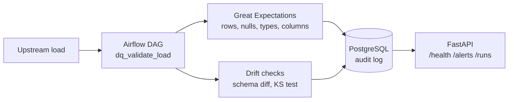

# Results and method details

Moved out of the README. Raw numbers are in `results/eval_results.json`; intervals are in `results/eval_results.md`.

## Full results

Known defects are injected into clean 500 row loads and the checks are run on both. Detection rate is the share of defective loads that raised an alert from the matching check. False-positive rate is the share of clean loads flagged by that same check.

Command: `make eval` (same as `python -m dqf.evaluate --trials 200 --seed 7`, 484 s on a laptop). Raw numbers are in `results/eval_results.json`.

| Defect | Level | Detection rate | False-positive rate |
|---|---|---|---|
| nulls | 2% of one column | 137/200 = 68.5% | 0/200 = 0.0% |
| nulls | 10% of one column | 200/200 = 100.0% | 0/200 = 0.0% |
| nulls | 30% of one column | 200/200 = 100.0% | 0/200 = 0.0% |
| schema change | drop column | 200/200 = 100.0% | 0/200 = 0.0% |
| schema change | rename column | 200/200 = 100.0% | 0/200 = 0.0% |
| schema change | add column | 200/200 = 100.0% | 0/200 = 0.0% |
| schema change | retype column | 200/200 = 100.0% | 0/200 = 0.0% |
| value drift | one column +5% | 9/200 = 4.5% | 0/200 = 0.0% |
| value drift | one column +20% | 182/200 = 91.0% | 3/200 = 1.5% |
| value drift | one column +50% | 200/200 = 100.0% | 1/200 = 0.5% |
| row loss | 80% of rows kept | 0/200 = 0.0% | 0/200 = 0.0% |
| row loss | 50% of rows kept | 200/200 = 100.0% | 0/200 = 0.0% |
| row loss | 10% of rows kept | 200/200 = 100.0% | 0/200 = 0.0% |

Clean loads flagged by any check: 10 of 2600 (0.4%). The 95% intervals are in `results/eval_results.md`.

How to read this:
- The 2% null case is missed when the random column already has nulls in the real data (for example `passenger_count`, about 5% null), because the limit sits above that baseline. This is a threshold choice, not a bug.
- A 5% shift in one column is too small for a 500 row load against a 3,000 row reference. The test cannot see it.
- The row-loss limit is 40% either side of 500 rows, so an 80% load passes on purpose.
- Clean loads here are random draws from one month, so the false-positive rate is for data that is stable. Real upstream data will drift on its own and flag more.

Data: the public NYC TLC yellow taxi trip records, January 2024. A 10,000 row sample is committed in `data/sample/` so everything runs offline.

## How it works, in detail

- A baseline is built from `data/sample/reference.csv`: column types, null rate per column, and the reference values.
- Great Expectations checks row count (within 40% of 500), column set, column types, and a null limit per column. The limit is the baseline rate plus 1 point plus 4 standard errors for the load size.
- Schema drift compares the load's schema with the last accepted schema in the audit log and names the change, for example `type changed: tolls_amount number to string`. A load that breaks the contract is not used as the next reference.
- Value drift runs a two-sample KS test per numeric column against the reference (p below 0.001) and is a warning, not an error.
- Every run, finding and schema snapshot is written to PostgreSQL. The API only reads from it.

## Design choices, with the reasons

- **Great Expectations for the contract, scipy for drift.** GE is good at pass or fail rules. A distribution test is simpler to write and test as plain code.
- **Thresholds from the baseline, not constants.** First try was a flat 5% null limit. It was too loose for clean columns and too tight for columns that are null in the real data. Now each column gets its own limit.
- **Drift against the last accepted schema.** First try compared with the previous load, which made the next good load look like a change. Failed loads no longer become the reference.
- **Measure with injected defects.** Without known defects, "it caught issues" means nothing. The numbers above come from a script with a fixed seed.
- **pandas pinned below 3.** Great Expectations 1.24 does not recognise the new pandas 3 string type, so the type check failed on every clean load.
